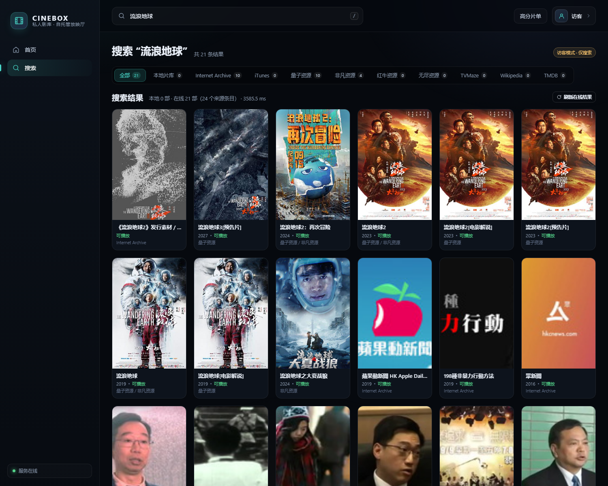
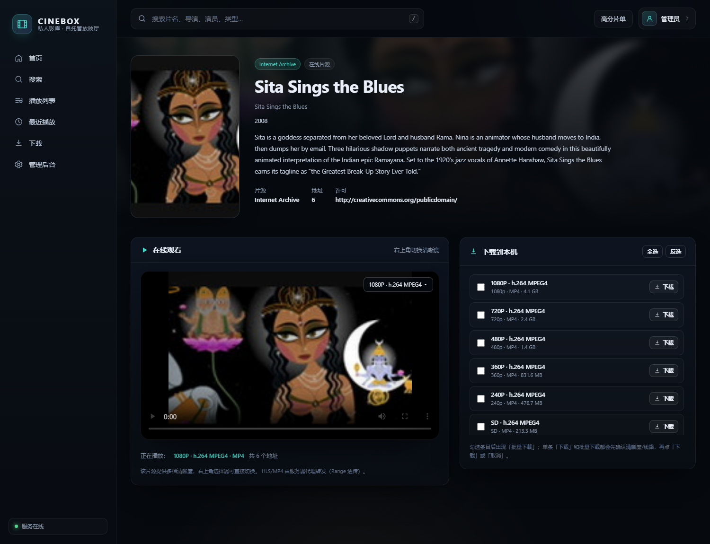
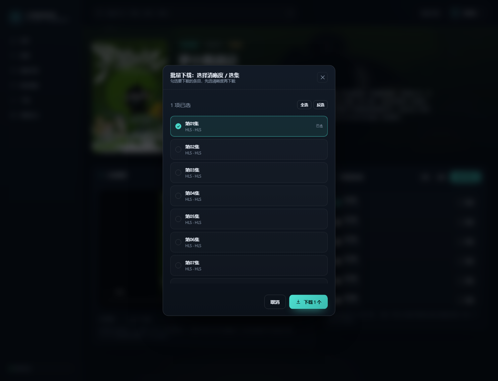
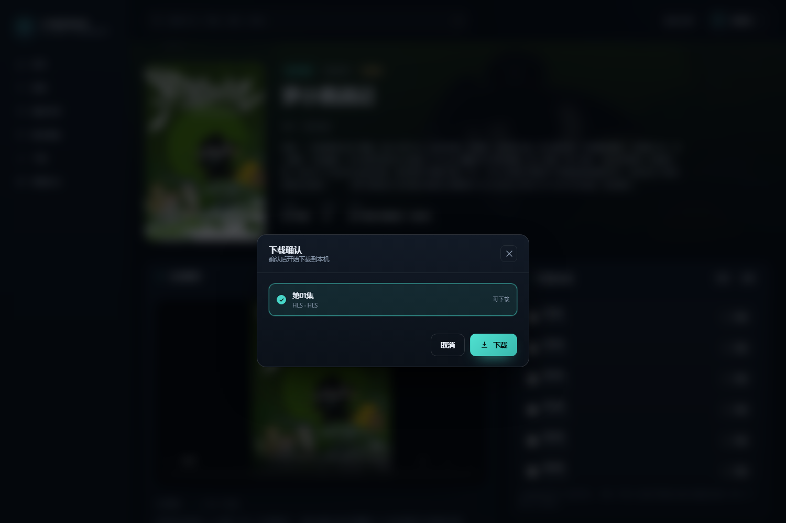
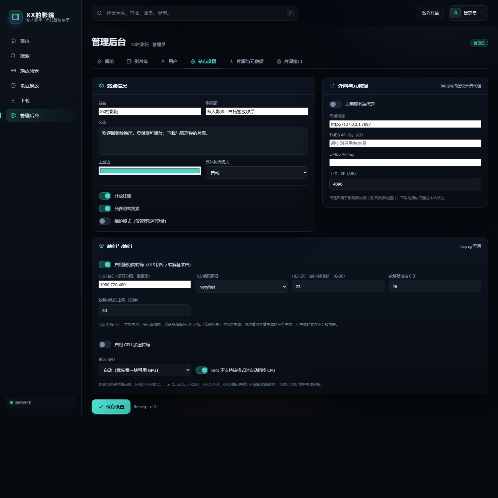
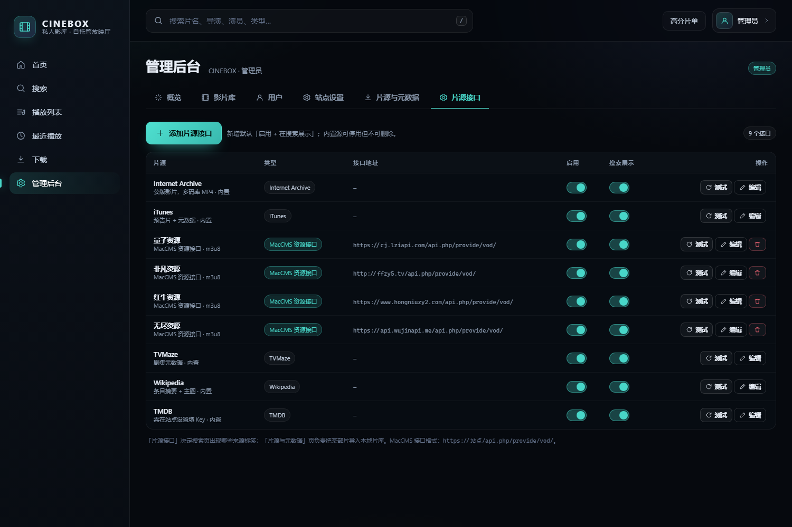

# PrivateCinema

**自托管影视站 · 聚合搜索 · 在线观看 · 下载到本机**

[](https://github.com/qigexiaoqi/PrivateCinema/releases)
[](LICENSE)
[](https://www.python.org/)
[](Dockerfile)

PrivateCinema 是一套**零第三方依赖**的影视站：搜索时并发查询多个在线片源 API，在线播放（HLS/MP4）与下载（可打包元数据），带登录、播放列表、最近播放和完整后台。部署只需要一台机器和 `python app.py`，或者一条 `docker compose up -d`。

- 前端：原生 ES2020 + 内置 hls.js，无构建步骤
- 后端：Python 标准库（`http.server` / `hashlib` / `zipfile`），`ffmpeg` 负责 HLS 与转封装
- 端口：**8426**
- 默认站名：`XX的影院`（后台可改）

---

## 界面预览

| 聚合搜索（去重 + 来源分栏） | 在线片源 · 播放器内切换 |
| --- | --- |
|  |  |

| 批量下载 · 勾选 + 全选/反选 | 单条下载 · 确认弹窗 |
| --- | --- |
|  |  |

| 后台 · 转码与编码（GPU） | 片源接口管理 |
| --- | --- |
|  |  |

更多截图见 [`docs/preview`](docs/preview)。版本变更见 [`CHANGELOG.md`](CHANGELOG.md)。

---

## 功能

| 模块 | 说明 |
| --- | --- |
| 聚合搜索 | 搜索时并发查询 Internet Archive / iTunes / TVMaze / Wikipedia / TMDB / 任意 MacCMS 资源站，按来源分栏，命中数实时显示 |
| 去重 | 「全部」按「片名 + 年份」合并重复条目，一部片一张卡，点进去可切换播放源 |
| 在线观看 | 播放器右上角切换清晰度/线路/选集；HLS 用 hls.js（MSE），MP4 直读；支持拖动、全屏、画中画 |
| 下载 | 单条/批量下载都会先选清晰度；HLS 自动转封装 MP4；服务器边读边转发，文件直接落到访问端 |
| 播放列表 / 最近播放 | 每个用户独立片单与进度记录，首页「继续观看」 |
| 登录与权限 | scrypt 密码 + HttpOnly 会话 + CSRF；访客仅可搜索，播放/下载需登录 |
| 用户管理 | 后台增删改用户、重置密码、禁用账号，**注册开关**（关闭后前端不显示注册） |
| 片源接口 | 后台可增删 API 源、启用/停用、控制是否在搜索页展示，支持在线测试 |
| 转码与编码 | HLS 档位/CRF/预设、软解基准档参数、**GPU 加速**（NVENC/QSV/AMF/VideoToolbox）与失败自动回退 CPU |
| 元数据 | 海报、背景、简介、评分、演职员；下载可勾选 NFO / JSON / 字幕 / 校验清单等打包 |
| 界面 | 深色影院风、响应式、骨架屏、Toast、无内联脚本（CSP 友好） |

---

## 快速开始

### 方式一：Docker（推荐）

```bash
git clone https://github.com/qigexiaoqi/PrivateCinema.git
cd PrivateCinema
docker compose up -d
# 打开 http://127.0.0.1:8426
```

或直接：

```bash
docker build -t privatecinema:1.0.1 .
docker run -d --name privatecinema -p 8426:8426 \
  -v "$PWD/data:/app/data" -v "$PWD/media:/app/media" \
  --restart unless-stopped privatecinema:1.0.1
```

数据持久化在 `data/`（站点状态）与 `media/`（本地片源、HLS、海报字幕）。

> GPU 转码：宿主机装好 NVIDIA Container Toolkit 后，取消 `docker-compose.yml` 里 `deploy.resources` 的注释；Intel QSV 需要挂载 `/dev/dri` 并安装驱动。

### 方式二：Windows 一键

双击 `start.bat`，窗口保持常驻（`Ctrl+C` 或关闭窗口即停止），浏览器会自动打开 `http://127.0.0.1:8426`。

### 方式三：Linux / 手动

```bash
python3 app.py            # 需要 Python 3.10+，ffmpeg 可选但强烈建议
```

首次启动会自动创建 `data/db.json` 与管理员账号：

- 账号：`admin`
- 密码：`admin`（**登录后立刻在「账号设置」修改**）

生成示例片库（可选）：

```bash
python seed.py --local    # 2 部本地演示片（1080/720/480 + HLS + 软解档）
python seed.py            # 额外导入 5 部 Internet Archive 公版影片
```

---

## 配置

所有配置都在 **后台 → 站点设置**，写入 `data/db.json`。

| 配置 | 默认 | 说明 |
| --- | --- | --- |
| 站名 | `XX的影院` | 品牌名，同时用于浏览器标题 |
| 默认解析模式 | 自动 | 播放器默认解码模式 |
| 开放注册 | 开 | 关闭后登录框不显示「注册」，注册接口返回 403 |
| 允许访客搜索 | 开 | 访客仅可搜索，其余功能需登录 |
| 服务端代理 | **关** | 国内访问 archive.org / TMDB 等时可填 `http://127.0.0.1:7897` 并开启 |
| TMDB / OMDb Key | 空 | 可选，填了会有更完整的元数据 |
| HLS 档位 / CRF / 预设 | `1080,720,480` / `23` / `veryfast` | 生成本地片源 HLS 阶梯 |
| 软解档 CRF / 时长上限 | `26` / `30` 分钟 | 「软解优先」按需生成的 Baseline 档 |
| GPU 加速转码 | 关 | 可选 NVENC / QSV / AMF / VideoToolbox，「首选 GPU」可指定 |
| GPU 失败自动切 CPU | 开 | 硬件编码不支持该格式时回退 libx264 |

环境变量：

| 变量 | 默认 | 说明 |
| --- | --- | --- |
| `PRIVATECINEMA_PORT` | `8426` | 监听端口（兼容旧名 `CINEBOX_PORT`） |
| `PRIVATECINEMA_HOST` | `0.0.0.0` | 监听地址 |
| `CINEBOX_OPEN` | — | 设为 `1` 启动后自动打开浏览器（start.bat 已设） |

---

## 片源与元数据 API

| 供应商 | 类型 | Key | 播放 |
| --- | --- | --- | --- |
| Internet Archive | 内置 | 免 | 多码率 MP4（1080p/720p/480p…） |
| iTunes | 内置 | 免 | 官方预告片 MP4 |
| TVMaze / Wikipedia / TMDB | 内置 | TMDB 需 Key | 仅元数据 |
| MacCMS 资源站（量子/非凡/红牛/无尽…） | 可增删 | 免 | 单线路 HLS + 网页播放 |

- 资源站接口格式：`https://站点/api.php/provide/vod/`，后台「片源接口」可添加、测试、启停、控制是否展示；
- 资源站**没有多清晰度**，只有一条 HLS（外加一个网页播放页）；只有 Internet Archive 这类源提供真实 1080P/720P 多档；
- 代理白名单会自动学习片源 CDN 域名（持久化在 `db.liveHosts`）。

---

## 常用接口

```
GET  /api/search?q=                  本地片库搜索
GET  /api/live/search?q=&sources=    聚合在线片源搜索（返回 items + groups）
GET  /api/live/item?provider=&uid=   单个在线片源详情（文件列表）
GET  /api/live/group?ids=            多源聚合详情
GET  /api/proxy?u=                   流媒体代理（Range，HLS 播放列表会重写分片 URL）
GET  /api/live/download?provider=&uid=&file=N[&format=m3u8]
                                      在线片源下载（HLS 默认转封装 MP4）
GET  /api/download/{movieId}/{fileId}?extras=poster,nfo,json,...
                                      本地片库下载（可打包元数据 ZIP）
GET  /api/auth/me                   当前会话 / 站点公开配置
POST /api/auth/login|register|logout
GET  /api/admin/*                    管理员接口（用户/影片/设置/片源/转码探测）
```

---

## 目录结构

```
PrivateCinema/
├─ app.py                 # HTTP 服务、路由、静态资源、SPA 回退
├─ seed.py                # 示例片库
├─ reset_state.py         # 清空播放记录/片单/会话等临时状态
├─ Dockerfile             # 镜像构建
├─ docker-compose.yml     # 一键部署
├─ cinelib/               # 存储/认证/搜索/播放/下载/供应商/转码
├─ web/                   # index.html + styles.css + core/player/admin/live.js
├─ data/                  # db.json（首次启动生成）
├─ media/                 # local / hls / soft / assets
├─ docs/preview/          # 截图
└─ tests/                 # 回归脚本（test_client.py / test_admin.py）
```

---

## 安全说明

- 密码使用 `scrypt(n=2^14, r=8, p=1)` + 随机盐；
- 会话为 32 字节随机 Token，HttpOnly + SameSite=Lax，7 天过期；改密会踢掉其它会话；
- 所有写操作校验 CSRF（双提交 Cookie + `X-CSRF`）；
- 代理只允许白名单域名 + 从片源学习到的 CDN 域名，避免变成开放代理；
- 登录限速：同 IP 10 分钟 8 次失败即拒绝；
- 前端无内联脚本，CSP 为 `default-src 'self'`。

---

## 测试

```bash
python tests/test_client.py   # 搜索/登录/详情/播放 Range/下载 ZIP/字幕/统计
python tests/test_admin.py    # 影片与用户 CRUD、设置、供应商、访客 403
```

---

## 常见问题

**Q：启动报端口占用？**
A：已有实例在跑；访问 `http://127.0.0.1:8426` 即可。换端口：`set PRIVATECINEMA_PORT=8430`。

**Q：搜不到资源站结果？**
A：后台「片源接口」点「测试」看接口是否可达；国内网络可能需要给服务端配代理。

**Q：下载很慢 / 没进度？**
A：HLS 下载需要先转封装，首个字节通常要等十几秒；大文件请用浏览器下载管理器。

**Q：能破解版权内容吗？**
A：本项目只做检索与代理播放，不提供、不破解任何受版权保护的片源；请自行确保片源合法。

---

## License

[MIT](LICENSE)
